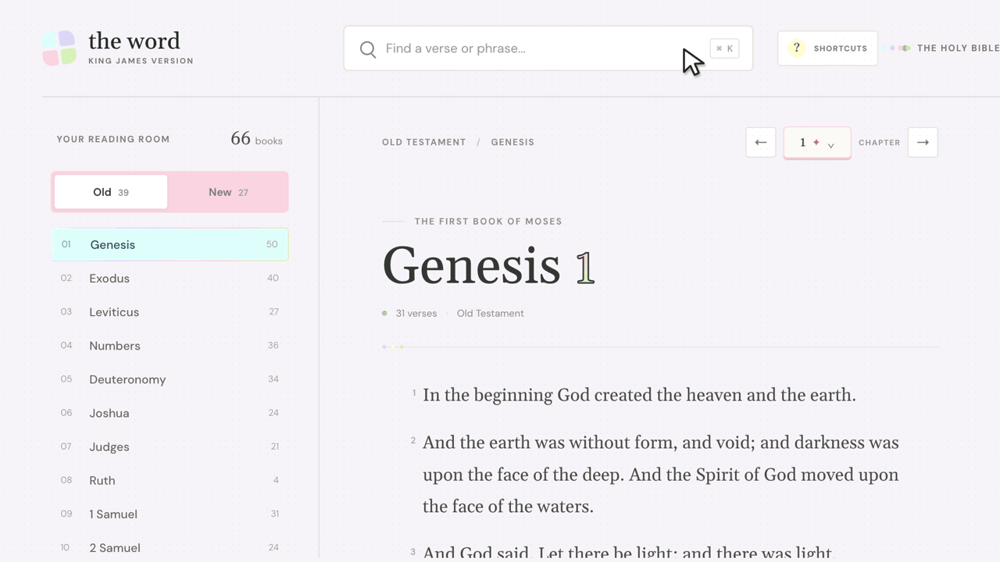

# Word

## About

An application that allows you to easily navigate the word of God.

```
"All scripture is given by inspiration of God,
and is profitable for doctrine, for reproof,
for correction, for instruction in righteousness:
That the man of God may be perfect,
thoroughly furnished unto all good works."
```

```
"For the word of God is quick, and powerful,
and sharper than any twoedged sword,
piercing even to the dividing asunder of soul and spirit,
and of the joints and marrow,
and is a discerner of the thoughts and intents of the heart.
Neither is there any creature that is not manifest in his sight:
but all things are naked and opened unto the eyes
of him with whom we have to do."
```

```
In the beginning was the Word,
and the Word was with God,
and the Word was God.

The same was in the beginning with God.

All things were made by him;
and without him was not any thing made that was made.
```

## Run locally

Start a local web server from this directory so the reader can load `kjv.json`:

```sh
python3 -m http.server 8000
```

Then open [http://localhost:8000](http://localhost:8000).

## Customize the palette

Edit the CSS custom properties at the top of `styles.css` to change the shared theme colors. The base pastels are `--blue`, `--lavender`, `--yellow`, `--pink`, and `--green`; the chapter number's higher-contrast gradient stops are `--chapter-blue`, `--chapter-lavender`, `--chapter-pink`, and `--chapter-green`.

## License

This project is jointly licensed under the terms of both of the following licenses:

* **[MIT License](LICENSE.md)**
* **[Polymorph License](LICENSE.md)**

By using, copying, modifying, or distributing this software, you agree to comply with the terms, conditions, and restrictions of **both** licenses simultaneously.

Please review the full text in the linked license file included in this repository for complete compliance details.

## Demo



The demo shows a pointer searching `John 3:16`, opening the shortcut guide, navigating with the arrow keys, and manually scrolling to the highlighted verse without an automatic jump. To refresh it, replace the numbered `assets/demo-frame-*.png` captures, then run:

```sh
swift tools/build-demo.swift
```